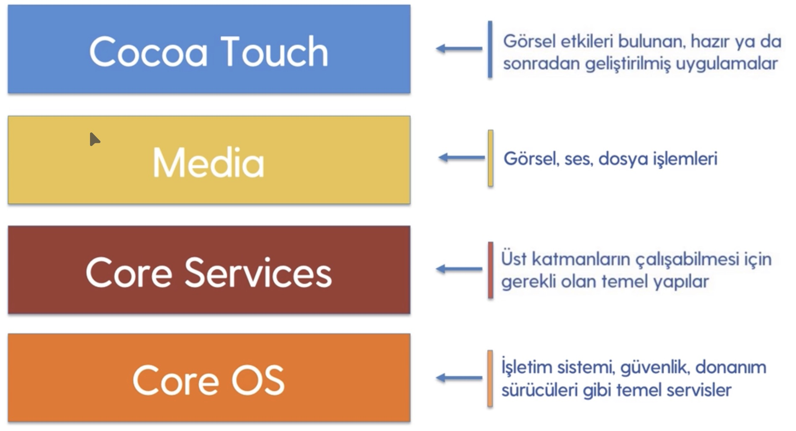

# iOS Mimarisi

# iOS Çalışma Mimarisi

iOS çalışma mimarisi, uygulamaların çalışmasını sağlayan ve farklı sorumluluklara sahip katmanlardan oluşur. Bu katmanlar, kullanıcı arayüzünden işletim sistemine ve donanım yönetimine kadar farklı görevler üstlenir.

  

### 1. Cocoa Touch

Cocoa Touch, geliştirdiğimiz iOS uygulamalarının çalıştığı ve kullanıcı etkileşiminin gerçekleştiği katmandır.

Kullanıcı arayüzü, dokunma olayları ve kullanıcı deneyimiyle ilgili yapılar bu katmanda bulunur.

Kendi geliştirdiğimiz uygulamaların yanı sıra cihaz üzerinde önceden yüklü olarak gelen Mesajlar ve Kişiler gibi uygulamalar da Cocoa Touch katmanında çalışır.

### 2. Media

Media katmanı, uygulamaların görsel ve işitsel içeriklerle çalışmasını sağlayan yapıları içerir.

Bu katmanda görsel, ses ve dosya işlemleriyle ilgili servisler bulunur. Uygulamalar, medya içeriklerini oluşturmak, işlemek ve görüntülemek için bu katmanın sunduğu olanaklardan yararlanır.

### 3. Core Services

Core Services, uygulamaların ihtiyaç duyduğu temel servisleri ve veri yapılarının yönetilmesini sağlayan katmandır.

Bu katmanda bulunan servislere örnek olarak:

- Yerel veritabanı işlemleri
- Konum servisleri
- Telefon işlemleri
- Uygulamaların ihtiyaç duyduğu temel sistem servisleri

verilebilir.

Bu servisler uygulamalar tarafından kullanılabilir; ancak servislerin temel çalışma ve yönetim süreçleri işletim sisteminin kontrolündedir.

### 4. Core OS

Core OS, iOS mimarisinin en alt katmanıdır. İşletim sistemi, güvenlik mekanizmaları, donanım sürücüleri ve donanımla ilgili temel servisleri kapsar.

Bu katman, üst katmanların çalışabilmesi için gerekli temel altyapıyı sağlar. Uygulama geliştiricileri Core OS katmanını doğrudan yönetmez; işletim sisteminin sunduğu API ve servisler üzerinden donanım ve sistem özelliklerinden yararlanır.

## Katmanları Bilmek Neden Önemlidir?

Bir iOS uygulaması geliştirirken yalnızca kullanıcı arayüzünü oluşturmak yeterli değildir. Uygulamanın çalıştığı platformun mimarisini ve katmanların sorumluluklarını da bilmek gerekir.

Bu mimariyi anlamak:

- Geliştirdiğimiz uygulamanın hangi katmanda çalıştığını anlamamızı,
- Kullanabileceğimiz sistem servislerini tanımamızı,
- Uygulamamızın platform üzerindeki yeteneklerini ve sınırlarını değerlendirmemizi,
- Uygulama mimarisini doğru şekilde tasarlamamızı

sağlar.