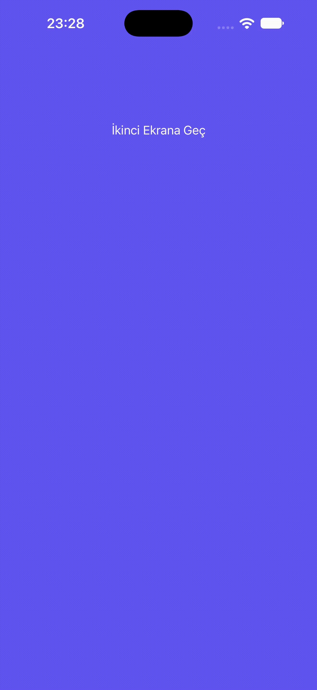
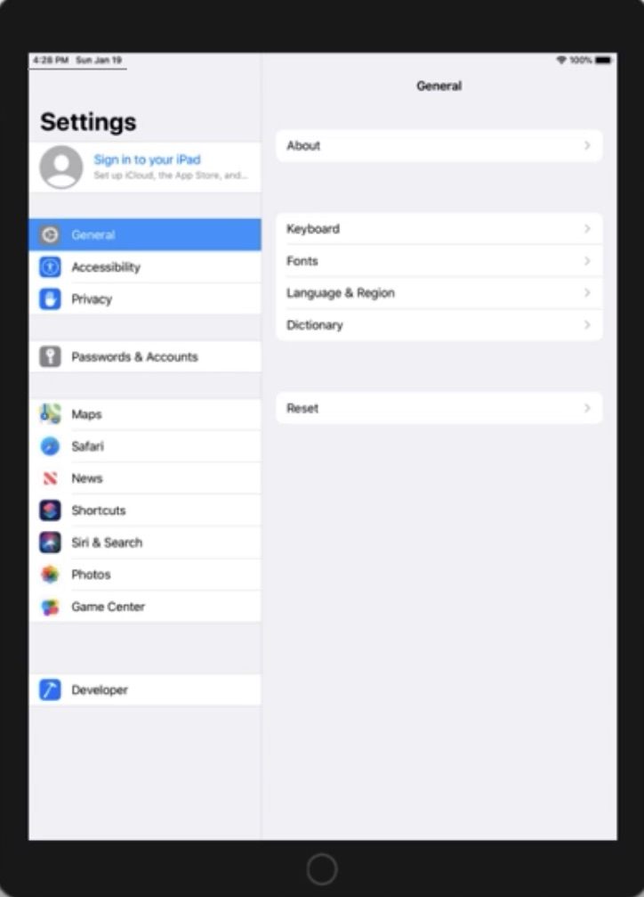
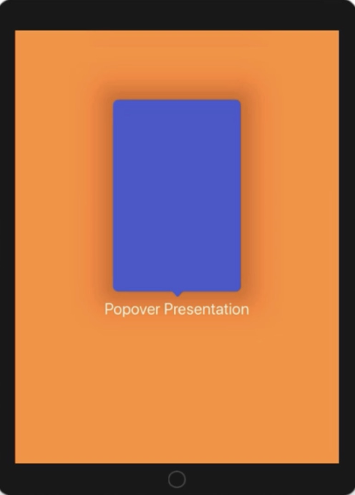

# Storyboard Segue Tipleri

## Segue Kavramı

Segue, bir ekrandan başka bir ekrana geçiş yapmak için kullanılan yapıdır. Storyboard üzerinde View Controller'lar arasında geçiş bağlantıları oluşturulmasını sağlar.

`UIStoryboardSegue`, `NSObject` sınıfından türetilmiş bir sınıftır. Bir Segue nesnesi içerisinde geçişin kaynağı, hedefi ve kimlik bilgisi bulunur.

Önemli özellik ve metotları:

- `source`: Geçişin başladığı View Controller'ı belirtir.
- `destination`: Geçişin hedefindeki View Controller'ı belirtir.
- `identifier`: Segue bağlantısına verilen kimliği temsil eder.
- `perform()`: Segue geçişini gerçekleştirir.

Segue işlemi sırasında kaynak View Controller'dan hedef View Controller'a geçiş yapılır. Hedef View Controller da kendi yaşam döngüsü sürecine girer.

## Segue Tipleri

Storyboard üzerinden kullanılabilen temel Segue türleri şunlardır:

- Show
- Show Detail
- Present Modally
- Popover Presentation
- Custom

### 1. Show Segue

Show Segue, bir ekrandan başka bir ekrana geçiş yapmak için kullanılır.

Genellikle Navigation Controller içerisinde kullanıldığında hedef View Controller navigation stack'e eklenir ve yeni ekrana geçilir. Navigation Controller bulunmayan durumlarda ise geçiş, mevcut arayüz bağlamına göre uygun bir sunum şekline uyarlanabilir.

Bu sayede ekranlar arasında standart bir geçiş sağlanır.

  

### 2. Show Detail

Show Detail, özellikle iPad uygulamalarında kullanılan, liste ve detay ekranlarının birlikte gösterildiği yapılarda tercih edilen bir geçiş türüdür.

Genellikle `UISplitViewController` ile birlikte kullanılır. Sol tarafta bir liste, sağ tarafta ise seçilen liste elemanına ait detay ekranı bulunur.

Kullanıcı listedeki bir öğeye dokunduğunda ilgili detay ekranı gösterilir.

  

Bu yapı özellikle geniş ekranlarda iki bölümün aynı anda görüntülenmesini sağladığı için kullanışlıdır.

### 3. Present Modally

Present Modally, mevcut View Controller'ın üzerinde yeni bir View Controller göstermek için kullanılır.

- Hedef View Controller, kaynak View Controller üzerinden sunulur.
- Kaynak View Controller'ın `UINavigationController` veya `UISplitViewController` içerisinde bulunması gerekmez.
- Yeni ekran, sunum stiline bağlı olarak kaynak ekranın üzerinde gösterilir.

Genellikle giriş formları, uyarı ekranları ve kullanıcıdan kısa süreli işlem beklenen ekranlarda tercih edilir.

### 4. Popover Presentation

Popover Presentation, yeni bir View Controller'ı küçük bir pencere içerisinde göstermeyi sağlar.

Genellikle iPad uygulamalarında tercih edilir. İçerik, küçük bir kutu içerisinde ve çoğunlukla bir ok işaretiyle ilişkili olduğu arayüz öğesine yönlendirilerek gösterilir.

Bilgilendirme, seçenek sunma veya ek detay gösterme gibi durumlarda kullanılabilir.

  

### 5. Custom

Show, Show Detail, Present Modally ve Popover Presentation gibi hazır geçiş türleri ihtiyacımızı karşılamadığında Custom Segue kullanabiliriz.

Custom Segue ile kendi ekranlar arası geçiş davranışımızı ve animasyonlarımızı tanımlayabiliriz.

**Hangi durumlarda tercih edilir?**

- Özel geçişler
- Özel gösterimler
- Özel animasyonlar

## Özet

Segue türleri, uygulamadaki ekranlar arasında farklı sunum ve geçiş biçimleri oluşturmamızı sağlar.

- **Show:** Standart ekran geçişleri
- **Show Detail:** Liste ve detay ekranlarının birlikte kullanıldığı yapılar
- **Present Modally:** Mevcut ekranın üzerinde yeni ekran sunulması
- **Popover Presentation:** Küçük bir pencere içerisinde içerik gösterilmesi
- **Custom:** Özel geçiş ve animasyon davranışlarının oluşturulması