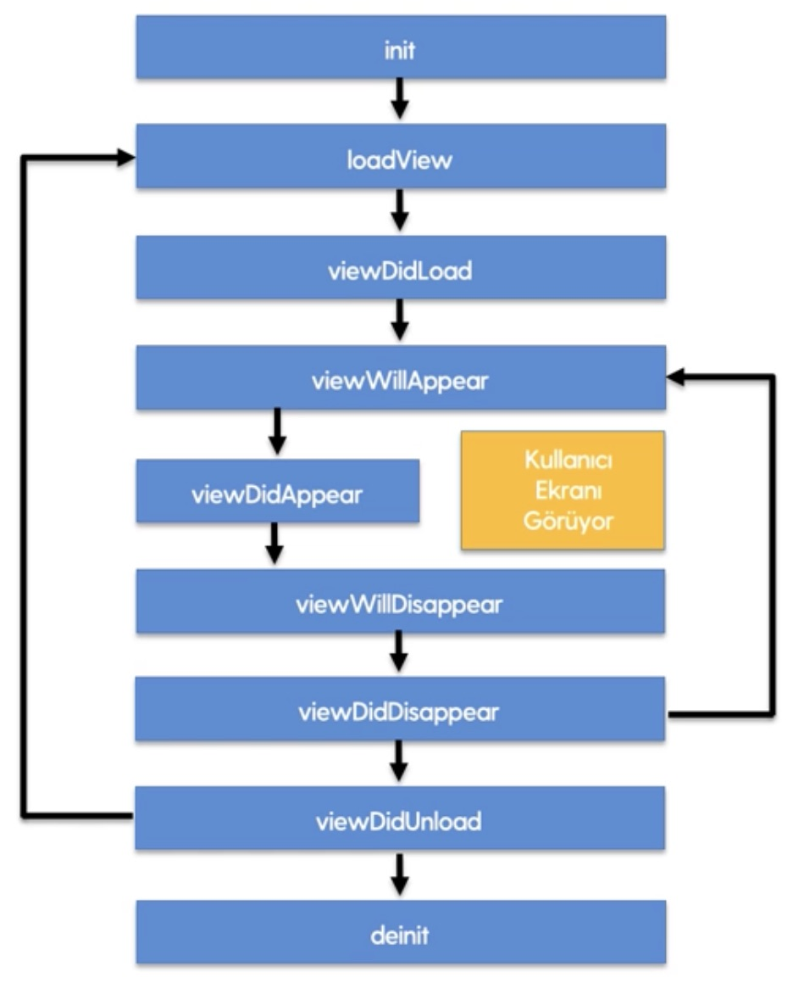

# View Controller Lifecycle

## View Controller Yaşam Döngüsü

iOS uygulamalarında her ekranın arkasında, o ekranı yöneten bir `UIViewController` nesnesi bulunur. Bu nesnelerin oluşturulmasından ekranda gösterilmesine ve bellekten kaldırılmasına kadar devam eden bir yaşam döngüsü vardır.

View Controller yaşam döngüsü UIKit tarafından yönetilir. Bu süreçte belirli aşamalarda tetiklenen metotları override ederek ekranın durumuna göre gerçekleştirmek istediğimiz işlemleri tanımlayabiliriz.

## Yaşam Döngüsü Metotları

### 1. init

View Controller nesnesinin oluşturulması sırasında initializer metotları çalışır.

- Programmatic olarak oluşturulan View Controller nesnelerinde `init(...)` kullanılır.
- Storyboard üzerinden oluşturulan View Controller nesnelerinde `init(coder:)` kullanılır.

Bu aşamada View Controller nesnesi oluşturulur. Ancak henüz View hiyerarşisinin yüklenmiş olması gerekmez.

### 2. loadView

View Controller'ın yöneteceği ana View nesnesinin oluşturulduğu veya yüklendiği metottur.

Storyboard veya XIB kullanıldığında View hiyerarşisi ilgili dosyadan yüklenir. Arayüzü tamamen programmatic olarak oluşturuyorsak `loadView()` metodunu override ederek ana View nesnesini kendimiz oluşturabiliriz.

View nesnesi henüz yüklenmeden önce bu View'a bağlı UI bileşenlerine erişilemez.

### 3. viewDidLoad

View hiyerarşisinin belleğe yüklenmesi tamamlandıktan sonra çağrılır.

Bu aşamada Label, Button, TextField gibi arayüz bileşenlerine erişebilir ve gerekli başlangıç ayarlarını yapabiliriz.

Genellikle:

- UI bileşenlerinin başlangıç ayarları
- Delegate ve DataSource atamaları
- İlk veri yükleme işlemleri
- Ekranın ilk yapılandırılması

gibi işlemler burada gerçekleştirilir.

`viewDidLoad`, View Controller'ın View'ı yüklendiğinde bir kez çağrılır. Ekrandan başka bir ekrana geçip geri dönmek, View bellekte tutulmaya devam ediyorsa bu metodun yeniden çağrılmasına neden olmaz.

### 4. viewWillAppear

View Controller'ın View'ı ekranda gösterilmeden hemen önce çağrılır.

Kullanıcı henüz ekranı görmeden önce yapılması gereken işlemler bu metotta gerçekleştirilebilir.

Örneğin:

- Güncel verilerin yenilenmesi
- Ekrandaki bilgilerin güncellenmesi
- Görünürlük öncesinde yapılması gereken kontroller

Bu metod, ekran her yeniden görüntüleneceğinde çağrılır.

### 5. viewDidAppear

View Controller'ın View'ı View hiyerarşisine eklendikten ve ekrana geçiş tamamlandıktan sonra çağrılır.

Bu aşamada kullanıcı ekranı görmektedir. Ekranın görünür olmasını gerektiren işlemler burada başlatılabilir.

Örneğin:

- Animasyonları başlatmak
- Görünür ekrana bağlı işlemleri çalıştırmak
- Kullanıcı etkileşimine bağlı süreçleri başlatmak

### 6. viewWillDisappear

View Controller'ın View'ı ekrandan kaldırılmadan hemen önce çağrılır.

Ekranın görünürlüğünü kaybetmeden önce yapılması gereken işlemler bu aşamada gerçekleştirilebilir.

Örneğin:

- Ekrandaki geçici durumun kaydedilmesi
- Görünürlükle ilişkili işlemlerin durdurulmaya hazırlanması
- Geçiş öncesi gerekli düzenlemelerin yapılması

### 7. viewDidDisappear

View Controller'ın View'ı View hiyerarşisinden kaldırıldıktan sonra çağrılır.

Bu aşamada ekran artık kullanıcı tarafından görülmez. Ekran görünür değilken devam etmesine gerek olmayan işlemler durdurulabilir.

### 8. deinit

View Controller nesnesi bellekten tamamen kaldırılmadan önce çağrılan deinitializer metodudur.

`viewDidDisappear` metodundan farklı olarak yalnızca ekranın görünmez olması nesnenin bellekten kaldırıldığı anlamına gelmez. Örneğin bir Navigation Controller içerisinde önceki ekrana ait View Controller, navigation stack içerisinde tutulmaya devam edebilir.

Nesne artık hiçbir güçlü referans tarafından tutulmadığında bellekten kaldırılır ve `deinit` çalışır. Gerekli kaynak temizliği bu aşamada yapılabilir.

## Ekrana Geri Dönüldüğünde Ne Olur?

Bir View Controller'dan başka bir ekrana geçildiğinde genellikle şu metotlar çağrılır:

1. `viewWillDisappear`
2. `viewDidDisappear`

Önceki ekrana geri dönüldüğünde ise:

1. `viewWillAppear`
2. `viewDidAppear`

metotları yeniden çalışır.

View Controller nesnesi ve View hiyerarşisi bellekte tutuluyorsa `init`, `loadView` ve `viewDidLoad` yeniden çağrılmaz.

Bu nedenle ekran her görüntülendiğinde güncel verilerle işlem yapmak istiyorsak bu işlemleri yalnızca `viewDidLoad` içerisinde gerçekleştirmek yeterli olmayabilir. Ekranın yeniden görünmesinde güncellenmesi gereken veriler için `viewWillAppear` uygun bir noktadır.

## Önemli Notlar

### viewDidUnload (Deprecated)

`viewDidUnload`, eski iOS sürümlerinde düşük bellek koşullarında View Controller'ın View nesneleri bellekten kaldırıldığında çağrılabilen bir metottu.

Ancak iOS 6 ve sonrasında View nesneleri düşük bellek koşullarında bu şekilde otomatik olarak bellekten temizlenmez. Bu nedenle `viewDidUnload` artık kullanılmayan, deprecated bir metottur ve güncel yaşam döngüsünün bir parçası olarak düşünülmemelidir.

Bu yüzden eski kaynaklarda veya diyagramlarda `viewDidUnload` görülse bile güncel UIKit geliştirmelerinde bu metoda güvenilmemelidir.

### View Controller ve Application Lifecycle Farkı

View Controller yaşam döngüsü ile uygulamanın yaşam döngüsü birbirinden farklıdır.

`viewWillDisappear` ve `viewDidDisappear` gibi metotlar ekranın View hiyerarşisindeki görünürlük değişiklikleriyle ilgilidir. Telefon araması gelmesi, uygulamanın arka plana alınması veya başka bir sistem olayının gerçekleşmesi her durumda bu metotların çağrılacağı anlamına gelmez.

Uygulamanın aktif, pasif veya arka planda olma durumları ayrıca application ve scene lifecycle üzerinden yönetilir.

## Neden Önemlidir?

View Controller yaşam döngüsünü bilmek, ekranların hangi aşamada yüklendiğini, ne zaman kullanıcıya gösterildiğini ve ne zaman görünmez olduğunu anlamamızı sağlar.

Bu metotları doğru kullanmak:

- UI bileşenlerine doğru zamanda erişmemizi,
- Verileri uygun aşamada yüklememizi ve güncellememizi,
- Ekran görünür değilken gereksiz işlemleri durdurmamızı,
- Bellek ve kaynak yönetimini doğru yapmamızı,
- Ekranlar arası geçişlerde beklenen davranışı sağlamamızı

sağlar.

## References

- [UIViewController – Apple Developer Documentation](https://developer.apple.com/documentation/uikit/uiviewcontroller)
- [viewDidLoad() – Apple Developer Documentation](https://developer.apple.com/documentation/uikit/uiviewcontroller/viewdidload\(\))
- [viewDidUnload – Apple Developer Documentation](https://developer.apple.com/documentation/uikit/uiviewcontroller/viewdidunload)
