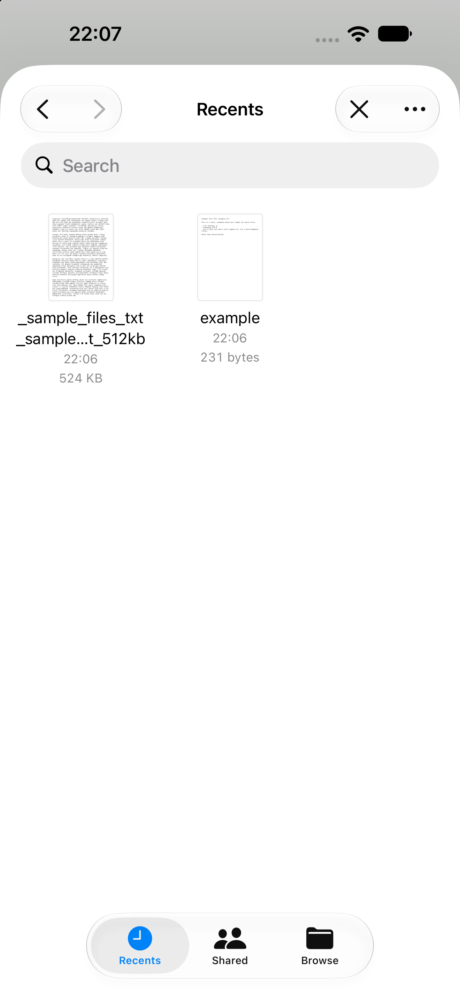

# FileManagerBasics

Swift ve UIKit kullanılarak geliştirilen bu proje, iOS uygulamalarında dosya sistemiyle çalışmanın temel yöntemlerini göstermek amacıyla hazırlanmıştır.

Uygulamada uygulamanın kendi Documents dizininde dosya oluşturma, yazma, okuma ve silme işlemleri gerçekleştirilir. Ayrıca `UIDocumentPickerViewController` kullanılarak kullanıcı tarafından seçilen metin dosyalarına erişilir.

## Ekran Görüntüsü

<p align="center">
  
</p>

## Özellikler

- Uygulamanın Documents dizinine erişme
- Dosya oluşturma ve içerik yazma
- Dosya içeriğini okuma
- Dosya silme
- Document Picker ile metin dosyası seçme
- Seçilen dosyanın içeriğini okuma
- Dosya işlemlerinde hata yakalama

## FileManager Nedir?

`FileManager`, uygulamanın dosya sistemiyle etkileşim kurmasını sağlayan Foundation sınıfıdır.

Dosya ve dizin oluşturma, kopyalama, taşıma, silme ve mevcut dosyalara erişme gibi işlemlerde kullanılır.

### Documents Directory

iOS uygulamaları sandbox adı verilen izole bir dosya alanında çalışır. Uygulamanın kendi dosyalarını saklayabileceği dizinlerden biri `Documents` dizinidir.

Projede bu dizine erişmek için `FileManager.default.urls(for:in:)` kullanılır:

```swift
let directoryURL = FileManager.default.urls(
    for: .documentDirectory,
    in: .userDomainMask
).first
```

`documentDirectory`, uygulamanın Documents dizinini; `userDomainMask` ise kullanıcının uygulama alanını belirtir.

Dosya adını bu dizinin URL'sine ekleyerek dosyanın konumu oluşturulur:

```swift
let fileURL = directoryURL.appendingPathComponent("fileName.txt")
```

## Temel Dosya İşlemleri

Projede dosya işlemleri tek bir buton üzerinden sırasıyla gerçekleştirilir.

| İşlem | Kullanılan API | Açıklama |
|---|---|---|
| Write | `String.write(to:atomically:encoding:)` | Dosyaya metin yazar. |
| Read | `String(contentsOf:encoding:)` | Dosyanın içeriğini okur. |
| Delete | `FileManager.removeItem(at:)` | Dosyayı siler. |

İşlemler `do-catch` bloğunda yürütülür. Böylece dosya bulunamaması veya yazma/okuma hatası gibi durumlar yakalanabilir.

**Not:** Bu örnekte dosya oluşturulur, içeriği okunur ve ardından silinir. Dolayısıyla işlem tamamlandığında Documents dizininde bu dosyadan kalıcı bir kopya bırakılmaz.

## UIDocumentPickerViewController

`UIDocumentPickerViewController`, kullanıcının uygulama dışındaki dosyalara sistem dosya seçicisi üzerinden erişmesini sağlar.

Projede yalnızca düz metin dosyalarının seçilmesine izin verilir:

```swift
let documentPickerViewController =
    UIDocumentPickerViewController(
        forOpeningContentTypes: [.plainText],
        asCopy: true
    )
```

- `.plainText`: Seçilebilir dosya türünü sınırlar.
- `asCopy: true`: Seçilen dosyanın uygulamaya bir kopyasının alınmasını sağlar.
- `delegate`: Dosya seçimi veya iptali gibi sonuçları takip eder.

Kullanıcı dosya seçtiğinde `documentPicker(_:didPickDocumentsAt:)` çağrılır. Seçilen dosyanın içeriği `Data(contentsOf:)` ile okunur ve UTF-8 kullanılarak String'e dönüştürülür.

Kullanıcı seçim ekranını kapatırsa `documentPickerWasCancelled(_:)` metodu çağrılır.

## Kullanılan Teknolojiler

- Swift
- UIKit
- Foundation
- FileManager
- URL
- Data
- UIDocumentPickerViewController
- UniformTypeIdentifiers

## Öğrenilen Konular

- iOS dosya sistemi ve sandbox yapısı
- Documents dizinine erişme
- URL ile dosya konumu oluşturma
- Dosya yazma, okuma ve silme
- UIDocumentPickerViewController kullanımı
- UIDocumentPickerDelegate metotları
- Data ve String dönüşümü
- do-catch ile dosya hatalarını yönetme

## Apple Developer Kaynakları

- [Using the File System Effectively](https://developer.apple.com/documentation/foundation/using-the-file-system-effectively) – iOS dosya sistemi ve dizinlerin kullanımı.
- [FileManager](https://developer.apple.com/documentation/foundation/filemanager) – Dosya ve dizin işlemleri.
- [FileManager.urls(for:in:)](https://developer.apple.com/documentation/foundation/filemanager/urls(for:in:)) – Sistem dizinlerine erişme.
- [FileManager.removeItem(at:)](https://developer.apple.com/documentation/foundation/filemanager/removeitem(at:)) – Dosya veya dizin silme.
- [UIDocumentPickerViewController](https://developer.apple.com/documentation/uikit/uidocumentpickerviewcontroller) – Sistem dosya seçicisi.
- [UIDocumentPickerDelegate](https://developer.apple.com/documentation/uikit/uidocumentpickerdelegate) – Dosya seçimi ve iptal işlemlerini takip etme.
- [Data(contentsOf:options:)](https://developer.apple.com/documentation/foundation/data/init(contentsOf:options:)) – URL üzerinden dosya verisi okuma.
- [String Writing to a URL](https://developer.apple.com/documentation/foundation/nsstring/write(to:atomically:encoding:)) – Metin içeriğini dosyaya yazma.