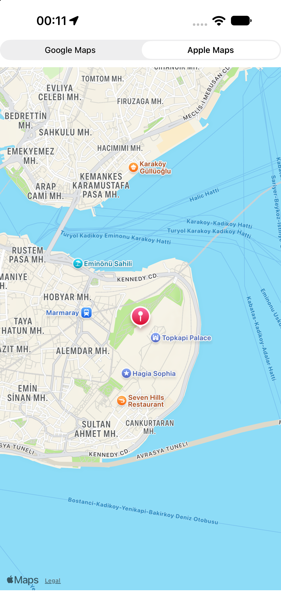
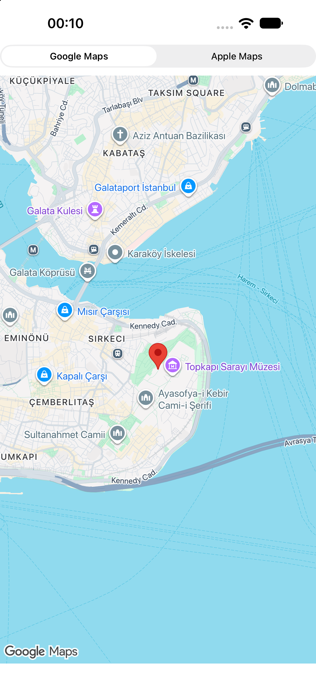

# MapsBasics

Bu proje, iOS uygulamalarında harita ve konum özelliklerinin kullanımını gösterir. Apple'ın **Core Location** ve **MapKit** framework'leri ile **Google Maps SDK** kullanılarak iki farklı harita sağlayıcısı aynı ekran üzerinden deneyimlenebilir.

## Ekran Görüntüleri

<table>
  <tr>
    <td align="center" width="50%">
      
       
      <strong>Apple Maps</strong>
    </td>
    <td align="center" width="50%">
      
       
      <strong>Google Maps</strong>
    </td>
  </tr>
</table>

## Uygulama Akışı

- Uygulama açıldığında Google Maps varsayılan harita olarak gösterilir.
- Ekranın üst kısmındaki `UISegmentedControl` üzerinden Google Maps ve Apple Maps arasında geçiş yapılabilir.
- **Google Maps** seçildiğinde harita Topkapı Sarayı'nın koordinatlarına odaklanır ve konum üzerinde bir işaretçi (marker) gösterilir.
- **Apple Maps** seçildiğinde cihazın konum izni kontrol edilir ve izin verilmişse mevcut konum harita üzerinde gösterilir.
- Konum izni reddedilmişse kullanıcıya bir uyarı gösterilir. Kullanıcı, uygulama ayarlarına yönlendirilerek konum iznini değiştirebilir.

## Core Location

Core Location, cihazın konum bilgisine erişmek ve konum güncellemelerini takip etmek için kullanılan Apple framework'üdür.

Projede `CLLocationManager` ile konum yönetimi gerçekleştirilir:

- `CLLocationManager`: Konum servislerini yönetir.
- `desiredAccuracy`: İstenen konum doğruluğunu belirler. Projede `kCLLocationAccuracyBest` kullanılmıştır.
- `requestAlwaysAuthorization()`: Kullanıcıdan her zaman konum erişimi izni ister.
- `locationManagerDidChangeAuthorization`: Konum izni durumundaki değişiklikleri takip eder.
- `startUpdatingLocation()`: Konum güncellemelerini başlatır.
- `didUpdateLocations`: Yeni konum bilgisi alındığında çağrılır.
- `didFailWithError`: Konum alınırken oluşan hataları yakalar.

Konum izni reddedildiğinde kullanıcıya `UIAlertController` üzerinden Ayarlar ekranını açma seçeneği sunulur.

## MapKit

MapKit, Apple Maps haritalarını uygulama içerisinde görüntülemek ve harita üzerinde konumlarla çalışmak için kullanılan framework'tür.

Projede `MKMapView` kullanılarak Apple haritası gösterilir.

- `MKCoordinateRegion`: Haritanın merkez koordinatını ve görüntüleme alanını belirler.
- `setRegion(_:animated:)`: Haritayı belirlenen koordinata odaklar.
- `MKAnnotation`: Harita üzerinde konum işaretçileri oluşturmak için kullanılır.

Mevcut konum bilgisi `CLLocationCoordinate2D` üzerinden alınır ve özel `MapAnnotation` sınıfı aracılığıyla haritaya eklenir.

## Google Maps SDK

Google Maps SDK, Google haritalarını iOS uygulamalarına entegre etmeyi sağlar. Projeye Swift Package Manager üzerinden [Google Maps SDK](https://github.com/googlemaps/ios-maps-sdk) eklenmiştir.

Projede:

- `GMSMapView` ile Google haritası görüntülenir.
- `GMSCameraPosition` ile haritanın başlangıç koordinatı ve yakınlaştırma seviyesi belirlenir.
- `GMSMarker` ile harita üzerinde işaretçi oluşturulur.
- Marker başlığı ve açıklaması `title` ve `snippet` özellikleriyle tanımlanır.
- `GMSServices.provideAPIKey()` ile Google Maps API anahtarı SDK'ya tanıtılır.

Google Maps API anahtarı `GOOGLE_MAPS_API_KEY` isimli ortam değişkeninden okunur. Anahtarın Xcode Scheme üzerinden tanımlanması gerekir; gizli API anahtarları kaynak koduna veya Git deposuna eklenmemelidir.

## Kullanılan Teknolojiler

- Swift
- UIKit
- Core Location
- MapKit
- Google Maps SDK
- Swift Package Manager
- Storyboard

## Kaynaklar

- [Apple Developer – Core Location](https://developer.apple.com/documentation/corelocation)
- [Apple Developer – MapKit](https://developer.apple.com/documentation/mapkit)
- [Google Maps SDK for iOS](https://developers.google.com/maps/documentation/ios-sdk)
- [Google Maps SDK – GitHub](https://github.com/googlemaps/ios-maps-sdk)