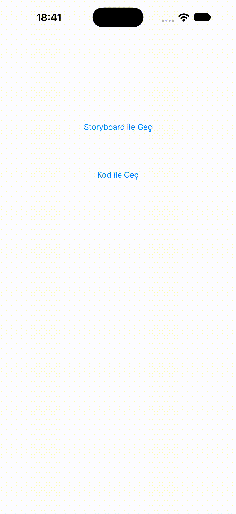

# Navigation Flow

Bu proje, UIKit kullanılarak geliştirilen bir iOS uygulamasında **UINavigationController ile ekranlar arası gezinmenin nasıl yönetildiğini** göstermektedir.

Uygulamada Navigation Controller tarafından yönetilen bir ekran akışı oluşturulmuştur. Farklı ekranlara Storyboard üzerinden doğrudan geçiş yapılması, kod yardımıyla bir segue'nin tetiklenmesi ve navigation stack kullanılarak önceki ekrana dönülmesi ele alınmıştır.

## Ekran Görüntüsü

<p align="center">
  
</p>

## Navigation Controller Nedir?

`UINavigationController`, iOS uygulamalarında ekranlar arasındaki hiyerarşik gezinmeyi yöneten bir container view controller'dır.

Ekranları bir **navigation stack** içerisinde tutar. Yeni bir ekrana geçildiğinde ekran stack'e eklenir; önceki ekrana dönüldüğünde ise mevcut ekran stack'ten çıkarılır.

Navigation Controller, bu geçişleri yönetmenin yanı sıra navigation bar üzerinden kullanıcıya gezinme kontrolleri sunar.

### Navigation Stack

Navigation Controller, ekranları Last In, First Out (LIFO) mantığıyla yönetir.

- **Push:** Yeni bir View Controller navigation stack'e eklenir.
- **Pop:** Mevcut View Controller navigation stack'ten çıkarılır ve önceki ekrana dönülür.
- **Root View Controller:** Navigation stack'in başlangıç ekranıdır. Normal bir `popViewController` işlemiyle stack'ten çıkarılmaz.

Bu projede `ViewController` navigation stack'in root ekranıdır. Diğer ekranlara geçişler bu ekran üzerinden gerçekleştirilir.

## Ekranlar Arası Geçiş Yöntemleri

Projede iki farklı geçiş yöntemi kullanılmıştır.

### 1. Storyboard Üzerinden Geçiş

İlk buton, Storyboard'da tanımlanan bir `Show` segue bağlantısı aracılığıyla `BlueViewController` ekranına geçiş yapar.

Bu yöntemde herhangi bir geçiş kodu yazmaya gerek yoktur. Interface Builder üzerinden kaynak ve hedef View Controller arasında segue bağlantısı oluşturulur.

Navigation Controller içerisinde gerçekleştirilen `Show` segue, hedef ekranı navigation stack'e ekler.

### 2. Kod ile Segue Tetikleme

İkinci butona basıldığında `navigateProgrammaticallyButtonTapped(_:)` metodu çalışır.

```swift
@IBAction func navigateProgrammaticallyButtonTapped(_ sender: UIButton) {
    performSegue(withIdentifier: "showGreenScreen", sender: nil)
}
```

`performSegue(withIdentifier:sender:)` metodu, Storyboard üzerinde tanımlanmış bir segue'yi kod aracılığıyla tetikler.

Bu projede segue'nin identifier değeri `showGreenScreen` olarak belirlenmiştir. Geçişin hedef ekranı `GreenViewController`'dır.

Bu yöntemde geçiş kod içerisinden başlatılsa da hedef View Controller ve segue bağlantısı hâlâ Storyboard'da tanımlıdır.

> **Not:** `performSegue(withIdentifier:sender:)` ile `navigationController?.pushViewController(_:animated:)` aynı yöntem değildir. İlkinde Storyboard'da tanımlanan bir segue tetiklenirken, ikincisinde View Controller navigation stack'e doğrudan kod üzerinden eklenir.

## Navigation Stack'ten Geri Dönme

`BlueViewController` ekranında özel bir Back butonu bulunmaktadır. Butona basıldığında `backButtonTapped(_:)` metodu çalışır:

```swift
@IBAction func backButtonTapped(_ sender: UIButton) {
    navigationController?.popViewController(animated: true)
}
```

`popViewController(animated:)` metodu, mevcut ekranı navigation stack'ten çıkarır ve bir önceki ekrana döner.

Bu örnekte `BlueViewController` stack'ten çıkarılır ve kullanıcı tekrar root ekran olan `ViewController` ekranına yönlendirilir.

## Navigation Bar Yönetimi

Navigation Controller, ekranlar arasında gezinmeyi kolaylaştıran bir navigation bar sağlar. Ancak bazı ekranlarda bu barın gizlenmesi tercih edilebilir.

Projede `BlueViewController` açıldığında navigation bar gizlenir:

```swift
override func viewDidLoad() {
    super.viewDidLoad()

    navigationController?.setNavigationBarHidden(true, animated: false)
}
```

Ekrandan ayrılırken navigation bar yeniden görünür hâle getirilir:

```swift
override func viewWillDisappear(_ animated: Bool) {
    navigationController?.setNavigationBarHidden(false, animated: false)
}
```

Navigation bar gizlendiği için geri dönüş işlemi sistemin standart navigation bar geri butonu yerine ekrandaki özel Back butonu ile gerçekleştirilir.

## Uygulama Akışı

1. Uygulama bir Navigation Controller ile başlar. `ViewController` root ekran olarak tanımlanmıştır.
2. **Storyboard ile Geç** butonuna basıldığında `BlueViewController` ekranına Show segue ile geçilir.
3. **Kod ile Geç** butonuna basıldığında `performSegue(withIdentifier:)` çağrılır ve `GreenViewController` ekranına geçilir.
4. Blue ekranında navigation bar gizlenir.
5. Back butonuna basıldığında `popViewController(animated:)` çağrılır ve önceki ekrana dönülür.

## Kullanılan Teknolojiler

- Swift
- UIKit
- Xcode
- Storyboard
- UINavigationController
- UIViewController
- Show Segue
- Navigation Stack

## Öğrenilen Konular

- Navigation Controller'ın uygulama içerisindeki rolü
- Root View Controller kavramı
- Navigation Stack yapısı
- `UINavigationController` ile ekran geçişlerinin yönetilmesi
- Storyboard üzerinden Show Segue oluşturulması
- `performSegue(withIdentifier:sender:)` kullanımı
- `popViewController(animated:)` ile önceki ekrana dönülmesi
- Navigation bar'ın programatik olarak gizlenmesi ve gösterilmesi