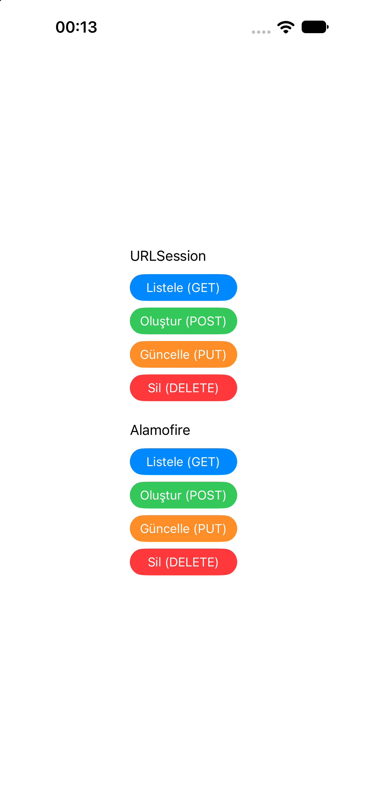

# Networking Basics

Bu proje, iOS uygulamalarında internet tabanlı işlemlerin nasıl gerçekleştirildiğini incelemek amacıyla hazırlanmıştır.

Uygulamada, HTTP isteklerini gerçekleştirmek için iki farklı yaklaşım kullanılır: Apple'ın yerleşik networking API'si olan **URLSession** ve üçüncü taraf networking kütüphanesi **Alamofire**.

Her iki yöntemle de GET, POST, PUT ve DELETE HTTP metotları kullanılarak temel CRUD işlemleri gerçekleştirilir.

## İnternet Tabanlı İşlemler

Mobil uygulamalarda internet bağlantısı birçok farklı amaçla kullanılır. Uygulama içeriğinin sunucudan getirilmesi, kullanıcı bilgilerinin işlenmesi, bildirimlerin gönderilmesi ve reklam veya tanıtım içeriklerinin sunulması bunlara örnektir.

Özellikle uygulama içeriklerinin dinamik olarak yönetilmesi gerektiğinde verilerin internet üzerinden bir sunucudan alınması gerekir.

<p align="center">
  
</p>

Kullanıcı bilgilerinin internet tabanlı sistemlerde işlenmesi durumunda KVKK kapsamında kişisel verilerin korunması, güvenli aktarılması ve uygun şekilde saklanması gibi gereksinimler dikkate alınmalıdır.

## İnternet Haberleşmesi İçin Gereksinimler

İnternet üzerinden veri alışverişi yapmadan önce bağlantı, güvenlik ve servis tarafındaki bazı gereksinimleri anlamak gerekir.

### İnternet Erişim Kontrolü

Bir uygulama internet üzerinden istek gönderdiğinde cihazın ağ bağlantısı bulunmayabilir veya bağlantı sırasında çeşitli sorunlar yaşanabilir.

Ağ durumunu izlemek için Apple'ın sunduğu `Network` framework içerisindeki `NWPathMonitor` kullanılabilir. Bu yapı, cihazın kullanılabilir ağ bağlantısındaki değişiklikleri takip etmeyi sağlar.

Ancak ağ bağlantısının mevcut olması, isteğin gönderildiği sunucunun mutlaka erişilebilir olduğu anlamına gelmez. Sunucu hataları, DNS problemleri veya bağlantı zaman aşımı gibi durumlar da oluşabilir.

Bu nedenle her servis çağrısında hata yönetimi yapılmalı ve başarısız istekler kontrol edilmelidir.

**Not:** Bu projede ayrıca bir internet bağlantısı izleyicisi uygulanmamıştır. Ağ ve istek hataları, URLSession ve Alamofire isteklerinin sonuçları üzerinden kontrol edilmektedir.

### Güvenli ve Güvensiz Bağlantılar (HTTP / HTTPS)

İnternet üzerinden veri aktarırken bağlantının güvenliği önemlidir.

- **HTTPS:** TLS kullanarak istemci ile sunucu arasındaki iletişimi şifreler.
- **HTTP:** İletişim şifrelenmeden gerçekleşir.

Apple'ın App Transport Security (ATS) özelliği, URL Loading System üzerinden yapılan bağlantılarda varsayılan olarak güvenli HTTPS bağlantılarını zorunlu tutar. Güvenlik gereksinimlerini karşılamayan HTTP bağlantıları engellenebilir.

HTTP kullanan bir servise erişmek zorunluysa `Info.plist` içerisinde `App Transport Security Settings` altında uygun istisnalar tanımlanabilir.

`Allow Arbitrary Loads` özelliğini `YES` yapmak tüm alan adları için ATS kısıtlamalarını geniş ölçüde devre dışı bırakır. Bu nedenle önerilen bir varsayılan çözüm değildir. Mümkünse yalnızca ihtiyaç duyulan alan adı için daha dar kapsamlı bir istisna tanımlanmalıdır.

**Not:** Bu projede kullanılan JSONPlaceholder adresi HTTPS kullandığı için ek bir ATS istisnasına ihtiyaç duyulmaz.

### Web Servis Bağlantıları

Uygulamaların internet üzerinden veri alışverişi yapabilmesi için web servislerine ihtiyaç duyulur.

Web servisleri, istemciden gelen HTTP isteklerini karşılar ve isteğin sonucunda bir HTTP yanıtı döndürür. Bu yanıt içerisinde durum kodu, header bilgileri ve varsa veri içeriği bulunur.

## Web Servisleri ve Veri Formatları

Web servisleri, istemciye farklı veri formatlarında yanıt döndürebilir. Yaygın olarak karşılaşılan formatlardan ikisi XML ve JSON'dur.

### XML Web Servisleri

XML servisleri, verileri etiketler (tags) kullanarak yapılandırılmış bir formatta sunar.

XML içerisinde açılış ve kapanış etiketlerinin kullanılması, aynı veri içeriği için daha fazla karakter oluşmasına neden olabilir.

### JSON Web Servisleri

JSON, verileri anahtar-değer çiftleri ve diziler aracılığıyla temsil eden hafif bir veri formatıdır.

Mobil uygulamalarda API yanıtlarının JSON formatında sunulması oldukça yaygındır. JSON verilerinin Swift modellerine dönüştürülmesi için `Codable`, `JSONDecoder`, `JSONSerialization` veya SwiftyJSON gibi araçlardan yararlanılabilir.

XML ve JSON arasındaki veri boyutu farkı içeriğin yapısına bağlıdır. XML genellikle daha fazla etiket içerdiğinden daha uzun olabilir; ancak her XML yanıtının JSON karşılığından iki kat büyük olacağını söylemek doğru değildir.

**Not:** REST, JSON ile aynı şey değildir. REST bir API mimari yaklaşımıdır. REST tabanlı servisler JSON veya XML gibi farklı veri formatlarında yanıt döndürebilir.

## Web Servis İşlemleri

Bir web servisini kullanmak için HTTP isteklerini kendimiz oluşturabilir veya bu işlemleri kolaylaştıran üçüncü taraf kütüphanelerden yararlanabiliriz.

Temel olarak bir servis çağrısı aşağıdaki aşamalardan oluşur.

<p align="center">
  
</p>

### 1. Servis Çağrısı (Request)

İlk olarak istek gönderilecek servis belirlenir ve HTTP isteği hazırlanır.

Bu aşamada ihtiyaçlara göre aşağıdaki bilgiler tanımlanır:

- HTTP method (GET, POST, PUT, DELETE vb.)
- URL adresi
- Header bilgileri
- Query parametreleri
- Request Body

### 2. Servis Sonucunu Yakalama (Response)

İstek gönderildikten sonra sunucudan olumlu veya olumsuz bir yanıt alınabilir.

Yanıt işlenmeden önce ağ hataları ve HTTP durum kodu kontrol edilmelidir. İsteğin başarılı olup olmadığı kontrol edilmeden yanıtın içeriğini kullanmaya çalışmak beklenmeyen sonuçlara veya uygulama hatalarına neden olabilir.

### 3. Sonucu Dönüştürme (Data Parsing)

İstek başarılı olduğunda sunucudan gelen veri uygulama içerisinde kullanılabilecek bir yapıya dönüştürülür.

JSON yanıtları için:

- `Codable` ve `JSONDecoder`
- `JSONSerialization`
- SwiftyJSON

gibi araçlar kullanılabilir.

Bu aşamada ham yanıt verisi, uygulamanın Model nesnelerine dönüştürülebilir.

## HTTP Methods ve CRUD İşlemleri

CRUD, veriler üzerinde gerçekleştirilen dört temel işlemi ifade eder.

| İşlem | HTTP Method | Açıklama |
| --- | --- | --- |
| Create | POST | Yeni kayıt oluşturur. |
| Read | GET | Mevcut kayıtları getirir. |
| Update | PUT | Mevcut kaydı tamamen günceller. |
| Delete | DELETE | Mevcut kaydı siler. |

## URLSession

`URLSession`, Apple tarafından Foundation framework içerisinde sunulan yerleşik networking API'sidir.

HTTP isteklerinin oluşturulması ve gönderilmesi için `URLRequest` ve `URLSessionDataTask` gibi yapılar kullanılabilir.

### URLRequest

`URLRequest`, HTTP isteğinin yapılandırılmasını sağlar.

Bu projede `URLRequest` üzerinden:

- İstek URL adresi belirlenir.
- `httpMethod` ile HTTP metodu tanımlanır.
- `allHTTPHeaderFields` veya `setValue(_:forHTTPHeaderField:)` ile Header bilgileri eklenir.
- `timeoutInterval` ile isteğin zaman aşımı süresi belirlenir.
- `httpBody` ile sunucuya gönderilecek veri tanımlanır.

Bu uygulamada isteklerin zaman aşımı süresi 30 saniye olarak ayarlanmıştır.

### HTTP Headers

HTTP Headers, istek ve yanıt hakkında ek bilgiler taşır.

Projede kullanılan Header alanları:

| Header | Açıklama |
| --- | --- |
| `Content-Type` | İstek gövdesinde gönderilen verinin formatını belirtir. |
| `Accept` | İstemcinin sunucudan beklediği yanıt formatını belirtir. |
| `Authorization` | Kimlik doğrulama bilgilerini taşımak için kullanılabilir. |

Örneğin:

```swift
request.setValue(
    "application/json",
    forHTTPHeaderField: "Accept"
)

request.setValue(
    "application/json",
    forHTTPHeaderField: "Content-Type"
)

// request.setValue(
//     "Bearer token",
//     forHTTPHeaderField: "Authorization"
// )
```

`Accept` ile sunucudan beklenen yanıt formatı, `Content-Type` ile ise gönderilen istek gövdesinin formatı belirtilir.

### Request Body

POST ve PUT gibi veri gönderen HTTP isteklerinde Request Body kullanılır.

Sunucuya gönderilen verinin formatı `Content-Type` Header değeriyle belirtilir.

Bu projede URLSession tarafında üç farklı Request Body formatı desteklenir:

**JSON**

JSON formatında veri göndermek için `JSONSerialization` kullanılır. Dictionary yapısındaki parametreler JSON Data formatına dönüştürülür.

```swift
request.httpBody = try JSONSerialization.data(
    withJSONObject: parameters
)
```

**URL-Encoded**

`application/x-www-form-urlencoded` formatında parametreler `key=value` yapısına dönüştürülür ve `&` karakteriyle birleştirilir.

Özel karakterler URL encoding işleminden geçirilerek gönderilmeye uygun hale getirilir.

Örnek:

```text
name=John+Doe&username=johndoe
```

**Plain Text**

`text/plain` formatında doğrudan metin içeriği UTF-8 Data formatına dönüştürülerek gönderilir.

```swift
request.httpBody = Data("Hello World".utf8)
```

Bu projede CRUD butonları JSON formatını kullanır. URL-Encoded ve Plain Text seçenekleri farklı servislerin ihtiyaç duyabileceği alternatif Request Body formatlarını göstermek amacıyla eklenmiştir.

### URLSessionDataTask

`URLSession.shared.dataTask(with:)`, HTTP isteğini asenkron olarak gerçekleştirmek için kullanılır.

Completion Handler içerisinde üç temel değer bulunur:

- `data`: Sunucudan dönen veri.
- `response`: HTTP yanıtına ait bilgiler.
- `error`: İstek sırasında oluşabilecek ağ hataları.

Bu projede:

1. Öncelikle ağ hatası kontrol edilir.
2. `HTTPURLResponse` üzerinden HTTP durum kodu alınır.
3. Durum kodunun `200...299` aralığında olup olmadığı kontrol edilir.
4. Yanıt verisi UTF-8 String formatına dönüştürülerek Console'a yazdırılır.
5. `resume()` çağrısıyla oluşturulan Data Task başlatılır.

URLSession'ın completion handler'ı asenkron olarak çalışır. Bu projede yanıtlar yalnızca Console'a yazdırıldığı için UI thread'e geçiş yapılmaz.

## Alamofire

Alamofire, Swift ile HTTP networking işlemlerini kolaylaştırmak için geliştirilen açık kaynaklı bir kütüphanedir.

URLSession üzerine daha kullanışlı bir API sunarak HTTP isteklerinin daha az kodla yapılandırılmasını sağlar.

Bu projede:

- `AF.request()` ile HTTP isteği oluşturulur.
- `HTTPMethod` kullanılarak GET, POST, PUT ve DELETE metotları belirlenir.
- `JSONEncoding.default` ile gönderilecek parametreler JSON formatında kodlanır.
- `validate()` ile HTTP yanıtının başarılı olup olmadığı kontrol edilir.
- `responseString` ile yanıt içeriği String olarak alınır.
- `response.result` üzerinden başarılı ve başarısız sonuçlar ayrıştırılır.

## Uygulama Arayüzü

Uygulama, URLSession ve Alamofire kullanılarak gerçekleştirilen HTTP işlemlerini aynı ekranda karşılaştırmalı olarak sunar.

Her iki yöntem için GET, POST, PUT ve DELETE işlemlerini başlatan ayrı butonlar bulunur.

<p align="center">
  
</p>

## API Endpoint

İstekler eğitim ve test amacıyla JSONPlaceholder servisi üzerinden gerçekleştirilir.

**Base URL:**

```text
https://jsonplaceholder.typicode.com/posts
```

Kullanılan endpoint'ler:

| HTTP Method | Endpoint | İşlem |
| --- | --- | --- |
| GET | `/posts` | Kayıtları listeleme |
| POST | `/posts` | Yeni kayıt oluşturma |
| PUT | `/posts/1` | Kaydı güncelleme |
| DELETE | `/posts/1` | Kaydı silme |

### Önemli: JSONPlaceholder Kalıcı Veri Saklamaz

JSONPlaceholder, HTTP isteklerini denemek ve API entegrasyonlarını test etmek için hazırlanmış sahte bir REST API servisidir.

POST, PUT ve DELETE isteklerine başarılı yanıtlar döndürse de bu işlemler sunucu tarafında kalıcı olarak saklanmaz.

Dolayısıyla:

- POST isteği yeni bir kayıt oluşturulmuş gibi yanıt döndürür.
- PUT isteği kayıt güncellenmiş gibi yanıt döndürür.
- DELETE isteği kayıt silinmiş gibi yanıt döndürür.
- Daha sonra GET isteği gönderildiğinde bu değişiklikler kalıcı olarak görünmez.

Bu nedenle servis, gerçek veri yönetimi için değil, HTTP isteklerinin çalışma mantığını öğrenmek için kullanılır.

## Kullanılan Teknolojiler

- Swift
- UIKit
- Foundation
- URLSession
- Alamofire
- HTTP Methods
- REST API
- JSON
- JSONSerialization
- URL Encoding

## Öğrenilen Konular

- iOS uygulamalarında internet tabanlı işlemlerin temel mantığı
- HTTP ve HTTPS arasındaki farklar
- App Transport Security (ATS)
- Web servisleri ve istemci-sunucu iletişimi
- XML ve JSON veri formatları
- HTTP Request ve Response yapısı
- HTTP Headers ve Request Body
- JSON, URL-Encoded ve Plain Text veri gönderimi
- GET, POST, PUT ve DELETE işlemleri
- URLSession ile HTTP istekleri oluşturma
- Alamofire ile networking işlemlerini gerçekleştirme
- JSON verilerini gönderme ve yanıtları işleme
- HTTP durum kodları ve hata yönetimi

## Referanslar

- [Apple Developer – URLSession](https://developer.apple.com/documentation/foundation/urlsession)
- [Apple Developer – URLRequest](https://developer.apple.com/documentation/foundation/urlrequest)
- [Apple Developer – NWPathMonitor](https://developer.apple.com/documentation/network/nwpathmonitor)
- [Apple Developer – App Transport Security](https://developer.apple.com/documentation/bundleresources/information-property-list/nsapptransportsecurity)
- [Alamofire – GitHub](https://github.com/Alamofire/Alamofire)
- [JSONPlaceholder – Guide](https://github.com/typicode/jsonplaceholder)