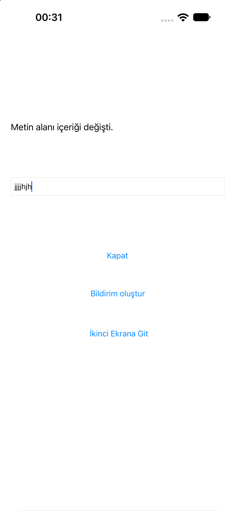
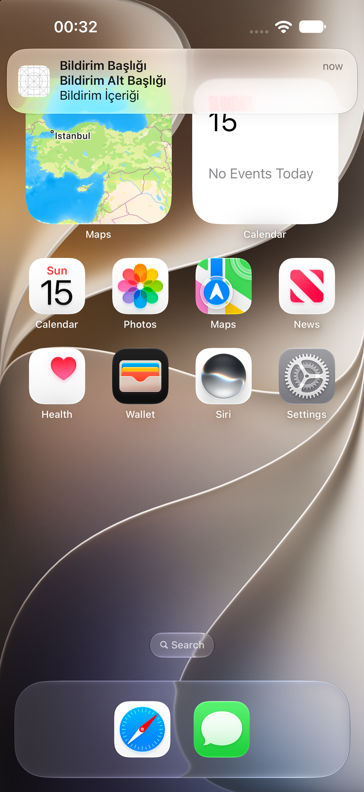

# NotificationCenter Basics

Bu proje, iOS uygulamalarında bildirim mekanizmalarının kullanımını gösterir. `NotificationCenter` ile uygulama içerisindeki olayların farklı ekranlar tarafından dinlenmesi, **User Notifications** framework'ü ile yerel bildirim oluşturulması ve push notification mantığı ele alınır.

## Ekran Görüntüleri

<table>
  <tr>
    <td align="center" width="50%">
      
       
      <strong>Ana Sayfa</strong>
    </td>
    <td align="center" width="50%">
      
       
      <strong>Yerel Bildirim</strong>
    </td>
  </tr>
</table>

## NotificationCenter Nedir?

`NotificationCenter`, uygulama içerisindeki nesnelerin birbirleriyle doğrudan bağlantı kurmadan olaylardan haberdar olmasını sağlayan bir bildirim mekanizmasıdır.

Bir nesne belirli bir bildirimi dinlemek için observer olarak kaydedilir. Başka bir nesne aynı bildirimi yayınladığında (`post`), ilgili observer'lar bu olayı yakalayabilir.

Bu yapı, özellikle farklı ViewController'lar arasında veri veya olay iletmek için kullanılabilir.

### NotificationCenter Kullanımı

Projede aşağıdaki bildirimler dinlenir:

- **Custom Notification:** Uygulamaya özel bildirim oluşturulur. `Notification.Name` extension ile özel bildirim adı tanımlanır.
- **TextField Notifications:** Metin alanında düzenleme başladığında ve içerik değiştiğinde bildirim alınır.
- **Keyboard Notifications:** Klavyenin açılması ve kapanması olayları takip edilir.

`ViewController` içerisinde `addObserver` kullanılarak dinleyiciler kaydedilir. İkinci ekrandaki `SecondaryViewController` ise `post` metoduyla özel bildirimi yayınlar.

Bildirimle birlikte ek veri göndermek için `userInfo` kullanılır. Ana ekrandaki observer, kendisine iletilen mesajı `Notification` nesnesi üzerinden alır.

## Yerel Bildirimler (Local Notifications)

Yerel bildirimler, uygulamanın kendi içerisinde oluşturup belirli bir zaman veya koşul gerçekleştiğinde kullanıcıya gösterebildiği bildirimlerdir. Uygulamanın bir sunucuya bağlanmasına gerek yoktur.

Projede yerel bildirim oluşturmak için **UserNotifications** framework'ü kullanılır.

- `UNUserNotificationCenter`: Bildirim izinlerini ve bildirim işlemlerini yönetir.
- `UNMutableNotificationContent`: Bildirimin başlık, alt başlık ve içerik bilgilerini tanımlar.
- `UNTimeIntervalNotificationTrigger`: Bildirimin ne kadar süre sonra gösterileceğini belirler.
- `UNNotificationRequest`: Bildirim içeriğini ve tetikleme koşulunu bir araya getirerek bildirim isteği oluşturur.
- `UNUserNotificationCenter.current().add()`: Bildirimi sisteme planlar.

### Uygulama Akışı

1. Uygulama açıldığında `requestAuthorization` ile bildirim gösterme, ses ve uygulama simgesi rozeti izinleri istenir.
2. Kullanıcı **Bildirim Oluştur** butonuna bastığında bir bildirim içeriği hazırlanır.
3. Bildirim 5 saniye sonra gösterilecek şekilde zamanlanır.
4. Bildirime dokunulduğunda `AppDelegate` içerisindeki `UNUserNotificationCenterDelegate` metodu çağrılır ve konsola bilgi yazdırılır.

## Uzaktan Bildirimler (Push Notifications)

Push notification, bir sunucu tarafından oluşturularak Apple Push Notification service (**APNs**) aracılığıyla kullanıcının cihazına iletilen bildirim türüdür.

Yerel bildirimlerden farklı olarak uygulama çalışırken kendi içinde bir bildirim planlamak zorunda değildir. Bildirim sunucu tarafından gönderilir ve APNs teslimat sürecini yönetir.

Push notification kullanım alanlarına örnekler:

- Sohbet uygulamalarında yeni mesaj bildirimi
- E-ticaret uygulamalarında sipariş durumu güncellemeleri
- Sosyal medya uygulamalarında beğeni ve yorum bildirimleri
- Hatırlatma ve önemli etkinlik duyuruları

Bu projede push notification kavramsal olarak ele alınmıştır; APNs üzerinden gerçek bir uzaktan bildirim gönderme ve alma entegrasyonu bulunmamaktadır.

## Bildirim Türleri Arasındaki Farklar

| Mekanizma | Kullanım amacı |
|---|---|
| NotificationCenter | Uygulama içindeki nesneler arasında olay iletimi |
| Local Notification | Uygulama tarafından planlanan yerel bildirimler |
| Push Notification | Sunucudan APNs aracılığıyla cihaza gönderilen bildirimler |

## Kullanılan Teknolojiler

- Swift
- UIKit
- Foundation – NotificationCenter
- UserNotifications
- UNUserNotificationCenterDelegate
- Storyboard

## Kaynaklar

- [Apple Developer – NotificationCenter](https://developer.apple.com/documentation/foundation/notificationcenter)
- [Apple Developer – User Notifications](https://developer.apple.com/documentation/usernotifications)
- [Apple Developer – Yerel Bildirim Zamanlama](https://developer.apple.com/documentation/usernotifications/scheduling-a-notification-locally-from-your-app)
- [Apple Developer – Uzaktan Bildirimler ve APNs](https://developer.apple.com/documentation/usernotifications/setting-up-a-remote-notification-server)