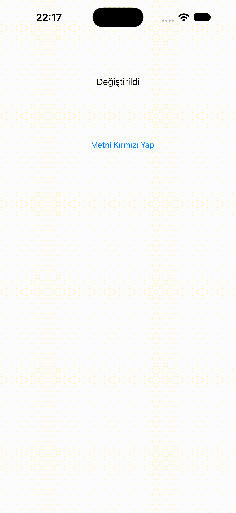
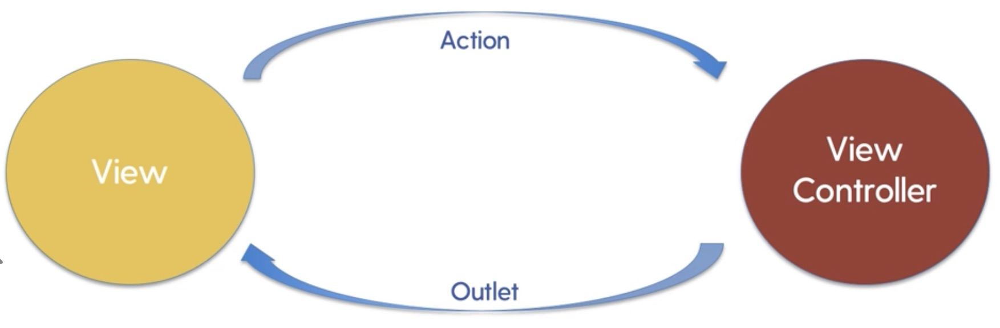

# Outlet Action Basics

Bu proje, UIKit kullanarak Storyboard üzerinde oluşturulan kullanıcı arayüzü bileşenleri ile View Controller arasındaki iletişimi sağlayan **IBOutlet** ve **IBAction** kavramlarını göstermek amacıyla hazırlanmıştır.

Uygulamada bir UILabel ve bir UIButton bulunur. Outlet bağlantısıyla Label'a erişilir, Action bağlantısıyla buton etkileşimi yakalanır. Kullanıcı butona bastığında Label'ın yazı rengi kırmızıya dönüştürülür.

## Ekran Görüntüsü

<p align="center">
  
</p>

## Outlet ve Action Kavramları

iOS uygulamalarında kullanıcı arayüzü ile View Controller arasında iletişim kurmak için **Outlet** ve **Action** bağlantıları kullanılır.

Outlet, ekrandaki arayüz bileşenlerine View Controller üzerinden erişmemizi sağlarken Action, kullanıcı etkileşimleri sonucunda View Controller içerisinde belirlediğimiz metotların çalışmasını sağlar.

<p align="center">
  
</p>

### Outlet

Outlet, ekranda bulunan bir View nesnesinin View Controller içerisindeki referansıdır.

Bir arayüz bileşenini kod tarafından kullanmak istediğimizde Outlet bağlantısı oluştururuz.

Outlet kullanımı özellikle şu durumlarda gereklidir:

- Ekrandaki bir View nesnesine erişmek istediğimizde
- Nesnenin herhangi bir özelliğini kullanmak istediğimizde
- Nesnenin mevcut özelliklerini değiştirmek istediğimizde

Outlet bağlantıları `@IBOutlet` anahtar kelimesi ile tanımlanır.

Örneğin bir Label'ın metnini değiştirmek veya bir Button'ın görünüm özelliklerine erişmek için ilgili bileşene Outlet bağlantısı oluşturulabilir.

Bu projede Label için aşağıdaki Outlet bağlantısı kullanılmıştır:

```swift
@IBOutlet weak var textLabel: UILabel!
```

`textLabel` referansı üzerinden UILabel nesnesinin metnine ve görünüm özelliklerine erişilebilir.

### Weak ve Strong

Swift'te sınıflar referans tipidir. Bir sınıf nesnesine verilen referanslar, ARC (Automatic Reference Counting) tarafından bellek yönetiminde dikkate alınır.

- **Strong:** Nesneye güçlü bir referans oluşturur. Nesnenin referans sayısını artırır ve nesnenin bellekte tutulmasını sağlar.
- **Weak:** Nesneyi güçlü şekilde tutmaz. Referans verilen nesne bellekten kaldırıldığında otomatik olarak `nil` olur.

IBOutlet bağlantılarında genellikle `weak` kullanılır. Bunun nedeni, Storyboard tarafından oluşturulan View hiyerarşisinin alt View nesnelerini zaten güçlü referanslarla tutmasıdır. View Controller'ın bu nesneleri ayrıca güçlü şekilde tutmasına gerek yoktur.

`weak` kullanımı eski `viewDidUnload` metoduyla ilişkili değildir. `viewDidUnload`, eski iOS sürümlerinde kullanılan ve iOS 6 ile birlikte kullanımdan kaldırılan bir metottur.

### Action

Action, ekrandaki bir kullanıcı etkileşimi veya olay gerçekleştiğinde View Controller içerisinde çalışan metottur.

Kullanıcı tarafından gerçekleştirilen etkileşimlere örnek olarak:

- Dokunma (Touch)
- Sürükleme (Drag)
- Diğer arayüz etkileşimleri

verilebilir.

Bir Action metodu `@IBAction` anahtar kelimesi ile tanımlanır.

Bir Action bağlantısı birden fazla olayı karşılayabilir. Böylece farklı kullanıcı etkileşimleri sonucunda aynı metot çalıştırılabilir.

Bu projede butona basıldığında çalışan Action metodu şöyledir:

```swift
@IBAction func buttonTapped(_ sender: UIButton) {
    textLabel.textColor = .red
}
```

Butona dokunulduğunda `buttonTapped(_:)` metodu çalışır ve Outlet üzerinden erişilen Label'ın `textColor` özelliği değiştirilir.

## Outlet ve Action Arasındaki Fark

| Outlet | Action |
| --- | --- |
| View nesnesine referans sağlar. | Olay gerçekleştiğinde metot çalıştırır. |
| Arayüz bileşenlerine kod üzerinden erişmek için kullanılır. | Kullanıcı etkileşimlerini karşılamak için kullanılır. |
| `@IBOutlet` ile tanımlanır. | `@IBAction` ile tanımlanır. |

## Interface Builder Bağlantıları

Storyboard üzerinde oluşturulan UI bileşenleri ile View Controller arasında bağlantı kurmak için Control + Drag işlemi kullanılabilir.

Bağlantı oluşturulurken:

- **Outlet:** UI bileşenine kod üzerinden erişmek için seçilir.
- **Action:** UI bileşeninin bir olayını karşılayacak metodu oluşturmak için seçilir.

Bu bağlantılar oluşturulduktan sonra Interface Builder üzerindeki Connections Inspector bölümünden kontrol edilebilir.

Koddan silinen IBOutlet veya IBAction bağlantıları Storyboard üzerinden de kaldırılmalıdır. Aksi takdirde uygulama çalışırken bağlantı hatalarıyla karşılaşılabilir.

## Uygulama Akışı

1. Uygulama açılır ve Storyboard üzerindeki arayüz yüklenir.
2. `textLabel` Outlet bağlantısı üzerinden UILabel nesnesine erişilir.
3. Label'ın başlangıç metni `Değiştirildi` olarak ayarlanır.
4. Kullanıcı **Metni Kırmızı Yap** butonuna basar.
5. `buttonTapped(_:)` Action metodu çalışır.
6. Label'ın yazı rengi `.red` olarak değiştirilir.

## Kullanılan Teknolojiler

- Swift
- UIKit
- UILabel
- UIButton
- IBOutlet
- IBAction
- Storyboard
- ARC (Automatic Reference Counting)

## Öğrenilen Konular

- Outlet ve Action kavramları
- `@IBOutlet` ile UI bileşenlerine erişme
- `@IBAction` ile kullanıcı etkileşimlerini karşılama
- Storyboard ve View Controller arasındaki bağlantılar
- UILabel özelliklerini kod üzerinden değiştirme
- Weak ve Strong referansların temel mantığı
- ARC ile bellek yönetimi