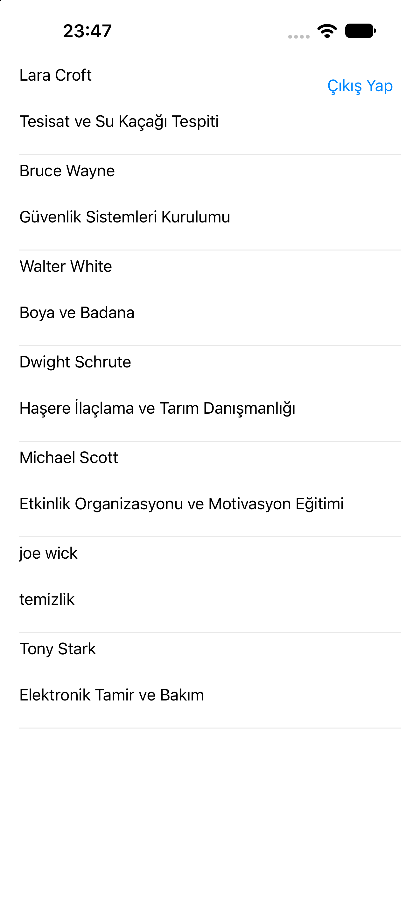
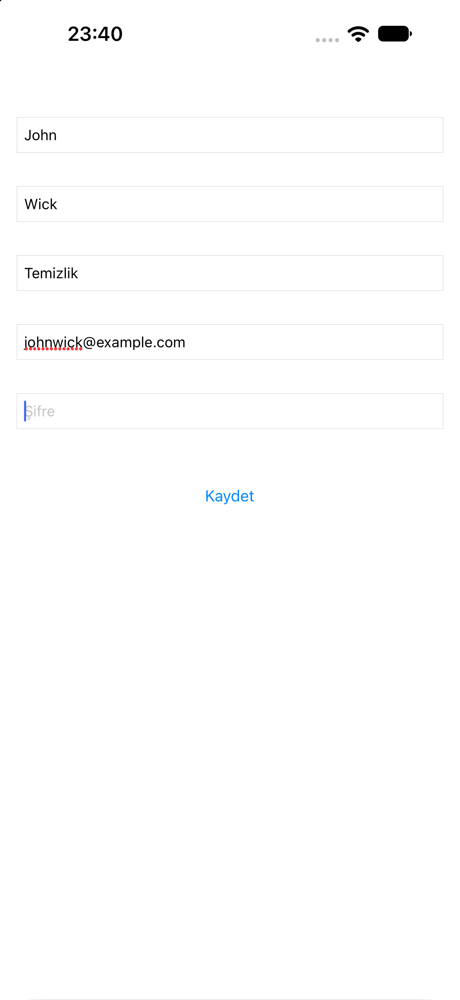

# Service Hub

ServiceHub, kullanıcıların sundukları hizmetleri paylaşabildiği ve diğer hizmet sağlayıcıları görüntüleyebildiği basit bir iOS uygulamasıdır. **Firebase Authentication** ile kullanıcı kaydı ve oturum yönetimi, **Firebase Realtime Database** ile hizmet veren kişilerin bilgilerinin saklanması ve listelenmesi sağlanır.

## Ekran Görüntüleri

<table>
  <tr>
    <td align="center" width="50%">
      
      <br />
      <strong>Ana sayfa</strong>
    </td>
    <td align="center" width="50%">
      
      <br />
      <strong>Kayıt Ekranı</strong>
    </td>
  </tr>
</table>

## Firebase

Firebase, Google tarafından sunulan ve mobil veya web uygulamalarının geliştirilmesini kolaylaştıran bir uygulama geliştirme platformudur. Uygulamaların ihtiyaç duyduğu sunucu tarafı işlevleri hazır servisler aracılığıyla sunar. Bu yaklaşım **Backend as a Service (BaaS)** olarak adlandırılır.

Firebase kullanılarak birçok farklı ihtiyaç karşılanabilir:

- **Kimlik doğrulama:** E-posta, şifre veya farklı kimlik sağlayıcılarıyla kullanıcı kaydı ve oturum yönetimi.
- **Veritabanı:** Kullanıcı bilgileri, mesajlar ve uygulama verilerinin saklanması; gerçek zamanlı veri senkronizasyonu.
- **Dosya depolama:** Profil fotoğrafları, görseller, videolar ve belgelerin bulutta saklanması.
- **Bildirimler:** Firebase Cloud Messaging ile uygulamalara push notification gönderilmesi.
- **Analiz ve hata takibi:** Kullanıcı etkileşimlerinin analiz edilmesi ve uygulama hatalarının izlenmesi.

Firebase; sohbet uygulamaları, sosyal medya platformları, e-ticaret uygulamaları, etkinlik ve rezervasyon sistemleri gibi pek çok farklı projede kullanılabilir.

## Uygulama Akışı

1. Uygulama açıldığında Firebase Realtime Database üzerinden kayıtlı hizmet sağlayıcılarının bilgileri alınır ve ana sayfadaki listede gösterilir.
2. Kullanıcı, hizmet sağlayıcı olarak sisteme katılmak için **Giriş Yap** butonuna basarak kayıt ekranını açar.
3. Kayıt ekranında ad, soyad, hizmet kategorisi, e-posta ve şifre bilgilerini girer.
4. Form alanlarının boş olup olmadığı kontrol edilir ve Firebase Authentication ile yeni kullanıcı hesabı oluşturulur.
5. Hesap oluşturulduğunda Firebase tarafından kullanıcıya özel bir UID üretilir. Ad, soyad ve hizmet kategorisi bilgileri bu UID kullanılarak Realtime Database'e kaydedilir.
6. Kayıt tamamlandığında ana sayfaya dönülür. Kullanıcı otomatik olarak oturum açmış olur ve buton **Çıkış Yap** olarak güncellenir.
7. Kullanıcı çıkış yaptığında Firebase Authentication oturumu kapatılır ve buton yeniden **Giriş Yap** hâline gelir.

## Firebase Entegrasyonu

### Firebase Authentication

Kullanıcı hesabı oluşturmak için `createUser(withEmail:password:)` metodu kullanılır. Bu işlem başarılı olduğunda kullanıcı otomatik olarak oturum açar.

Oturum durumu `Auth.auth().currentUser` üzerinden kontrol edilir. Kullanıcının oturumu açıksa `Çıkış Yap`, kapalıysa `Giriş Yap` başlığı gösterilir. Oturumu kapatmak için `Auth.auth().signOut()` kullanılır.

### Firebase Realtime Database

Kullanıcıların hizmet bilgileri veritabanında aşağıdaki yapıda saklanır:

```text
users
 ├── userID_1
 │    ├── firstName
 │    ├── lastName
 │    └── serviceCategory
 │
 └── userID_2
      ├── firstName
      ├── lastName
      └── serviceCategory
```

Veriler, Firebase Authentication tarafından oluşturulan kullanıcı UID'si altında tutulur. Böylece her kullanıcının hizmet bilgileri kendisine ait bir kayıtla ilişkilendirilir.

Ana ekranda `observe(.value)` dinleyicisi kullanılarak `users` referansındaki değişiklikler takip edilir. Yeni kayıt eklendiğinde veya veriler değiştiğinde güncel liste alınır ve TableView yenilenir.

## UITableView Entegrasyonu

Hizmet sağlayıcıları ana ekranda bir `UITableView` içerisinde listelenir. `ViewController`, `UITableViewDelegate` ve `UITableViewDataSource` protokollerini benimser.

- `numberOfRowsInSection`: Listede gösterilecek kullanıcı sayısını döndürür.
- `cellForRowAt`: Her satır için kullanıcı bilgilerini ilgili hücreye aktarır.
- `ServiceProviderTableViewCell`: XIB kullanılarak oluşturulan özel hücre tasarımıdır. Kullanıcının adı ve soyadı ile hizmet kategorisi bu hücrede gösterilir.

Veritabanından alınan kayıtlar `User` model nesnelerine dönüştürülerek `users` dizisinde tutulur. Ardından `reloadData()` çağrısıyla TableView güncellenir.

## Kullanılan Teknolojiler

- Swift
- UIKit
- UITableView, Custom Table View Cell ve XIB
- Firebase Authentication
- Firebase Realtime Database
- Firebase SDK ve Swift Package Manager
- Storyboard

## Kaynaklar

- [Firebase Dokümantasyonu](https://firebase.google.com/docs)
- [Firebase Authentication – iOS](https://firebase.google.com/docs/auth/ios/start)
- [Firebase Realtime Database – iOS](https://firebase.google.com/docs/database/ios/start)
- [Firebase Cloud Messaging](https://firebase.google.com/docs/cloud-messaging)
- [Apple Developer – UITableView](https://developer.apple.com/documentation/uikit/uitableview)