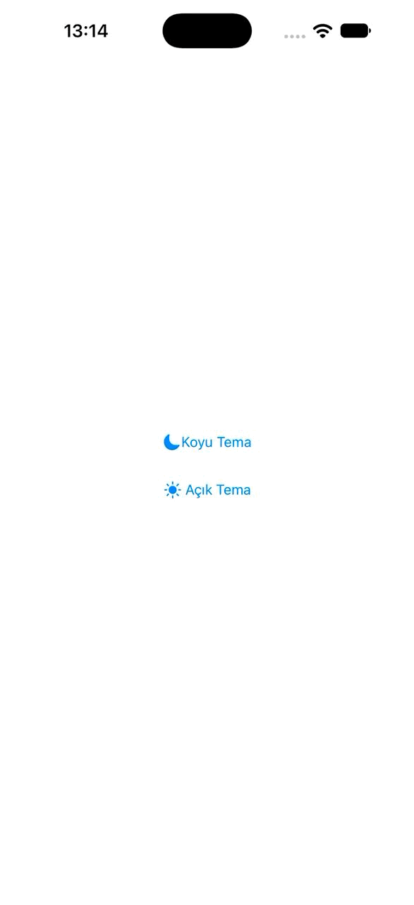

# ThemePreference

## Açıklama

Swift ve UIKit kullanılarak geliştirilen bu proje, `UserDefaults` ile kullanıcı tercihlerinin saklanmasını göstermek amacıyla hazırlanmıştır.

Kullanıcı açık veya koyu tema seçebilir. Seçilen tercih kaydedilir ve uygulama yeniden açıldığında tekrar uygulanır.

## Ekran Görüntüsü

<p align="center">
  
</p>


## UserDefaults Nedir?

`UserDefaults`, iOS uygulamalarında küçük miktardaki kullanıcı tercihlerini ve ayarlarını kalıcı olarak saklamak için kullanılan Foundation API'sidir.

Örneğin:

- Açık veya koyu tema tercihi
- Dil seçimi
- Bildirim ayarları
- Kullanıcı tercihleri

Uygulama kapatılıp yeniden açıldığında kaydedilen değerlere tekrar erişilebilir.

> UserDefaults; parola, erişim token'ı gibi hassas bilgileri veya büyük veri kümelerini saklamak için uygun değildir.

## Temel Kullanım

### 1. UserDefaults'a Erişme

```swift
let userDefaults = UserDefaults.standard
```

`UserDefaults.standard`, uygulamanın varsayılan veri deposuna erişim sağlar.

### 2. Veri Kaydetme

```swift
userDefaults.set("dark", forKey: "theme")
```

`set(_:forKey:)` metodu ile veri kaydedilir.

- `"dark"`: Saklanacak değer.
- `"theme"`: Değere erişmek için kullanılacak anahtar.

UserDefaults, verileri key-value mantığıyla saklar.

### 3. Veri Okuma

```swift
let selectedTheme = userDefaults.string(forKey: "theme") ?? "light"
```

`string(forKey:)`, belirtilen anahtardaki değeri String olarak döndürür.

Kayıtlı bir değer bulunamazsa `nil` döner. `?? "light"` sayesinde ilk açılışta varsayılan olarak açık tema kullanılır.

## Uygulamada Tema Yönetimi

Projede iki temel metot kullanılır:

**saveTheme(theme:)**

```swift
func saveTheme(theme: String) {
    let userDefaults = UserDefaults.standard
    userDefaults.set(theme, forKey: "theme")

    applyTheme()
}
```

Kullanıcının seçtiği tema UserDefaults'a kaydedilir ve ardından arayüz güncellenir.

**applyTheme()**

```swift
func applyTheme() {
    let userDefaults = UserDefaults.standard
    let selectedTheme = userDefaults.string(forKey: "theme") ?? "light"

    switch selectedTheme {
    case "dark":
        view.backgroundColor = .black

    case "light":
        view.backgroundColor = .white

    default:
        view.backgroundColor = .white
    }
}
```

Kayıtlı tema okunarak ViewController'ın arka plan rengi belirlenir.

### Uygulama Akışı

1. `viewDidLoad()` içerisinde `applyTheme()` çağrılır.
2. Kayıtlı tema UserDefaults üzerinden okunur.
3. Kullanıcı koyu veya açık tema butonuna basar.
4. Seçim `saveTheme()` ile kaydedilir.
5. `applyTheme()` çağrılarak arka plan güncellenir.
6. Uygulama yeniden açıldığında son kayıtlı tercih uygulanır.

## Proje Yapısı

```text
ThemeUserDefaults/
├── ThemeUserDefaults.xcodeproj/
└── ThemeUserDefaults/
    ├── AppDelegate.swift
    ├── SceneDelegate.swift
    ├── ViewController.swift
    ├── Assets.xcassets/
    └── Base.lproj/
        ├── Main.storyboard
        └── LaunchScreen.storyboard
```

## Kullanılan Teknolojiler

- Swift
- UIKit
- Foundation
- UserDefaults
- Storyboard
- IBAction

## Öğrenilen Konular

- UserDefaults'ın amacı ve kullanım alanları
- `UserDefaults.standard` ile depoya erişme
- `set(_:forKey:)` ile veri kaydetme
- `string(forKey:)` ile veri okuma
- Varsayılan değer belirleme
- Kullanıcı tercihlerinin uygulama açılışları arasında korunması