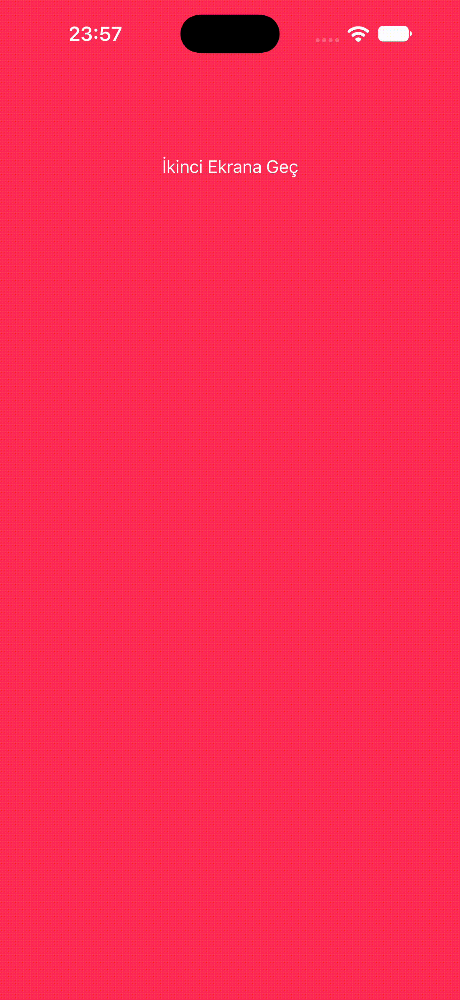

# ViewControllerLifecycle

Bu proje, UIKit içerisinde `UIViewController` yaşam döngüsünü (View Controller Lifecycle) uygulamalı olarak gözlemlemek amacıyla hazırlanmıştır.

Uygulamada iki farklı View Controller arasında ekran geçişi yapılır. Geçiş sırasında belirli yaşam döngüsü metotlarının ne zaman çağrıldığı `print()` ifadeleriyle Xcode Console üzerinden takip edilir.

## İlgili Dokümantasyon

View Controller yaşam döngüsü metotlarının görevleri, çağrılma sıraları ve kullanım amaçları hakkında ayrıntılı açıklamalar için:

**[View Controller Lifecycle – Teorik Dokümantasyon](../.documents/view-controller-lifecycle.md)**

Bu dokümanda aşağıdaki konular ele alınmaktadır:

- View Controller yaşam döngüsünün genel yapısı
- `init` ve `loadView`
- `viewDidLoad`
- `viewWillAppear` ve `viewDidAppear`
- `viewWillDisappear` ve `viewDidDisappear`
- `deinit`
- Ekrana geri dönüldüğünde yaşam döngüsü metotlarının davranışı
- Deprecated `viewDidUnload` metodu
- View Controller Lifecycle ve Application Lifecycle arasındaki fark

## Ekran Görüntüsü

<p align="center">
  
</p>

## Uygulama Yapısı

Uygulama iki View Controller'dan oluşur:

| View Controller | Açıklama |
|---|---|
| `ViewController` | Pembe arka planlı ilk ekran. İkinci ekrana geçişi başlatır. |
| `SecondViewController` | Kırmızı arka planlı ikinci ekran. Geri dönüş butonunu içerir. |

İlk ekrandan ikinci ekrana geçiş Storyboard üzerinde tanımlanan bir `Show Segue` aracılığıyla gerçekleştirilir. İkinci ekran tam ekran (Full Screen) olarak sunulur.

Geri dönüş işlemi ise `dismiss(animated:completion:)` metodu ile yapılır.

## Lifecycle Metotlarını Gözlemleme

View Controller sınıflarında bazı yaşam döngüsü metotları override edilerek Xcode Console'a mesaj yazdırılır.

Örneğin ilk ekrandaki `viewDidLoad()` metodu:

```swift
override func viewDidLoad() {
    super.viewDidLoad()

    print("first did load")
}
```

İkinci ekrandaki `viewDidLoad()` metodu:

```swift
override func viewDidLoad() {
    super.viewDidLoad()

    print("Second did load")
}
```

Bu sayede hangi View Controller'ın hangi aşamada yüklendiği konsol üzerinden takip edilebilir.

## Ekran Geçişlerinde Gözlemlenenler

### 1. Uygulamanın Açılması

Uygulama başlatıldığında ilk ekran yüklenir ve görünür hâle gelir.

- `ViewController` için `viewDidLoad()` çağrılır.
- `ViewController` için `viewDidAppear()` çağrılır.

### 2. İkinci Ekrana Geçiş

**İkinci Ekrana Geç** butonuna basıldığında Storyboard segue üzerinden `SecondViewController` açılır.

- İlk ekranın `viewDidDisappear()` metodu çağrılır.
- İkinci ekranın `viewDidLoad()` metodu çağrılır.
- İkinci ekranın `viewDidAppear()` metodu çağrılır.

### 3. İlk Ekrana Geri Dönüş

**Geri Dön** butonuna basıldığında aşağıdaki metot çalışır:

```swift
@IBAction func backButtonTapped(_ sender: Any) {
    dismiss(animated: true, completion: nil)
}
```

İkinci ekran kapatılır ve ilk ekrana geri dönülür.

İlk ekran tekrar görünür hâle geldiğinde `viewDidAppear()` yeniden çağrılır. Ancak ilk View Controller ve View hiyerarşisi bellekte tutulduğu için `viewDidLoad()` tekrar çağrılmaz.

Bu davranış, `viewDidLoad()` ile ekranın her yeniden görüntülenmesi sırasında çalışan metotlar arasındaki farkı gözlemlemek açısından önemlidir.

## Kullanılan Teknolojiler

- Swift
- UIKit
- Xcode
- Storyboard
- UIViewController
- View Controller Lifecycle
- Show Segue
- `dismiss(animated:completion:)`
- `print()`

## Öğrenilen Konular

- View Controller yaşam döngüsünü uygulamalı olarak gözlemleme
- Lifecycle metotlarının çağrılma zamanlarını anlama
- Ekran geçişleri sırasında yaşam döngüsünün nasıl ilerlediğini inceleme
- `viewDidLoad()` ile `viewDidAppear()` arasındaki farkı gözlemleme
- Ekrana geri dönüldüğünde View Controller'ın yeniden yüklenip yüklenmediğini anlama
- Xcode Console üzerinden yaşam döngüsü olaylarını takip etme